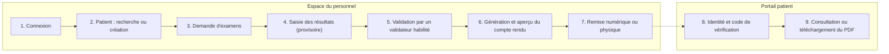

# Backlog produit

**Application de gestion des examens biologiques**

Centre Médical Anne-Mathias

  

| Information | Valeur |
| --- | --- |
| Version | 2.0 |
| Type de document | Backlog produit fonctionnel |
| Statut | Proposition à valider avec le Centre Médical Anne-Mathias |
| Périmètre | Application du personnel + portail patient |
| Objectif principal | Gérer le parcours complet d'un examen, de l'enregistrement du patient à la remise du compte rendu |

> **Légende des priorités :** 🔴 **P0** critique (MVP) · 🟠 **P1** importante · 🔵 **P2** évolution

## Sommaire

1. [Vision du produit](#section-1)
2. [Règles de priorité](#section-2)
3. [Résumé du backlog](#section-3)
4. [Backlog détaillé par Epic](#section-4)
   - [EPIC-01 · Authentification et accès](#epic-01)
   - [EPIC-02 · Tableau de bord](#epic-02)
   - [EPIC-03 · Gestion des patients](#epic-03)
   - [EPIC-04 · Demandes d'examens](#epic-04)
   - [EPIC-05 · Saisie et validation des résultats](#epic-05)
   - [EPIC-06 · Comptes rendus et remise](#epic-06)
   - [EPIC-07 · Portail patient](#epic-07)
   - [EPIC-08 · Notifications](#epic-08)
   - [EPIC-09 · Utilisateurs et sécurité](#epic-09)
   - [EPIC-10 · Paramètres](#epic-10)
   - [EPIC-11 · Interface, accessibilité et qualité](#epic-11)
5. [Parcours métier de bout en bout](#section-5)
6. [Plan de livraison proposé](#section-6)
7. [Règles métier à confirmer avant développement](#section-7)
8. [Critères de qualité communs](#section-8)
9. [Définition de « Terminé »](#section-9)
10. [Conclusion](#conclusion)

---

# 1. Vision du produit

L'application doit permettre au personnel autorisé de gérer les
patients, de créer des demandes d'examens, de saisir et valider les
résultats, puis de remettre les comptes rendus sous forme numérique ou
physique.

Le patient dispose d'un **portail distinct et sécurisé** lui permettant
de vérifier son identité, de confirmer son accès par code, de consulter
ses résultats publiés et de télécharger ses comptes rendus PDF.

## 1.1 Objectifs métier

| ID | Objectif | Résultat attendu |
| --- | --- | --- |
| OBJ-01 | Centraliser les dossiers patients | Les informations utiles sont retrouvables depuis une interface unique. |
| OBJ-02 | Suivre les demandes d'examens | Chaque demande possède un statut clair et une progression identifiable. |
| OBJ-03 | Sécuriser les résultats | Les résultats ne sont accessibles au patient qu'après validation et publication autorisée. |
| OBJ-04 | Simplifier la production des comptes rendus | Le compte rendu est généré à partir des résultats enregistrés et validés. |
| OBJ-05 | Tracer les opérations sensibles | Les actions importantes peuvent être attribuées à un utilisateur et consultées par une personne habilitée. |
| OBJ-06 | Faciliter l'accès du patient | Le patient peut retrouver et télécharger les documents qui lui sont destinés. |

## 1.2 Utilisateurs et responsabilités

| Profil | Responsabilités principales | Accès à encadrer |
| --- | --- | --- |
| Administrateur | Gérer les comptes, les rôles et les paramètres | Administration et données sensibles selon les règles de l'établissement |
| Accueil / personnel autorisé | Enregistrer les patients et créer ou suivre les demandes | Accès limité aux fonctions nécessaires |
| Personnel de laboratoire | Saisir les résultats et suivre les examens | Saisie et consultation selon les habilitations |
| Validateur habilité | Vérifier et valider les résultats | Validation et corrections contrôlées |
| Patient | Vérifier son identité, consulter les résultats publiés et télécharger ses PDF | Accès strictement limité à ses propres documents |

> Les intitulés exacts des rôles et leurs permissions doivent être
> confirmés par le Centre Médical Anne-Mathias.

---

# 2. Règles de priorité

| Priorité | Signification | Règle d'utilisation |
| --- | --- | --- |
| 🔴 **P0 — Critique** | Indispensable au parcours principal ou à la sécurité | À traiter pour le MVP |
| 🟠 **P1 — Importante** | Améliore le fonctionnement quotidien | À traiter après les fonctions P0 ou si la capacité le permet |
| 🔵 **P2 — Évolution** | Amélioration non essentielle au lancement | À planifier après le MVP |

## 2.1 Statuts de suivi suggérés

| Statut | Signification |
| --- | --- |
| À faire | Non commencé |
| En cours | Développement commencé |
| À tester | Fonctionnalité développée, en attente de vérification |
| Bloqué | Une décision ou dépendance empêche d'avancer |
| Terminé | Critères d'acceptation vérifiés |

---

# 3. Résumé du backlog

| Epic | Domaine | Nombre d'éléments | Priorité dominante |
| --- | --- | --- | --- |
| [EPIC-01](#epic-01) | Authentification et accès | 5 | 🔴 P0 |
| [EPIC-02](#epic-02) | Tableau de bord | 3 | 🟠 P1 |
| [EPIC-03](#epic-03) | Gestion des patients | 6 | 🔴 P0 |
| [EPIC-04](#epic-04) | Demandes d'examens | 7 | 🔴 P0 |
| [EPIC-05](#epic-05) | Saisie et validation des résultats | 6 | 🔴 P0 |
| [EPIC-06](#epic-06) | Comptes rendus et remise | 7 | 🔴 P0 |
| [EPIC-07](#epic-07) | Portail patient | 8 | 🔴 P0 |
| [EPIC-08](#epic-08) | Notifications | 4 | 🟠 P1 |
| [EPIC-09](#epic-09) | Utilisateurs et sécurité | 7 | 🔴 P0 |
| [EPIC-10](#epic-10) | Paramètres | 4 | 🟠 P1 |
| [EPIC-11](#epic-11) | Interface et qualité | 6 | 🔴 P0 / 🟠 P1 |

---

# 4. Backlog détaillé par Epic

## EPIC-01 — Authentification et accès

**Objectif :** permettre aux membres du personnel de se connecter et
garantir que chacun utilise uniquement les fonctions autorisées.

| ID | Fonctionnalité | User story | Critères d'acceptation | Priorité |
| --- | --- | --- | --- | --- |
| **AUTH-01** | **Connexion du personnel** | En tant que membre du personnel, je veux me connecter afin d'accéder à l'application. | • Un formulaire demande les identifiants requis. • Les identifiants valides ouvrent une session. • Les identifiants invalides affichent un message neutre. | 🔴 P0 |
| **AUTH-02** | **Rôles et permissions** | En tant qu'administrateur, je veux limiter l'accès selon les responsabilités. | • Chaque rôle possède des permissions définies. • Les accès interdits sont refusés côté serveur. • L'interface masque les actions non autorisées sans remplacer le contrôle serveur. | 🔴 P0 |
| **AUTH-03** | **Mot de passe oublié** | En tant qu'utilisateur, je veux demander une réinitialisation de mon mot de passe. | • Une demande peut être soumise. • Le message de retour ne révèle pas si un compte existe. • La procédure suit la politique de sécurité retenue. | 🟠 P1 |
| **AUTH-04** | **Déconnexion** | En tant qu'utilisateur, je veux fermer ma session de façon sûre. | • Une action de déconnexion est disponible. • La session est invalidée. • Les pages protégées ne restent pas accessibles après déconnexion. | 🟠 P1 |
| **AUTH-05** | **États d'erreur de connexion** | En tant qu'utilisateur, je veux comprendre pourquoi je ne peux pas me connecter sans exposer mes données. | • Les champs requis sont contrôlés. • Les erreurs sont lisibles. • Aucun mot de passe n'est affiché ou journalisé. | 🔴 P0 |

## EPIC-02 — Tableau de bord

**Objectif :** donner une vue rapide de l'activité et des tâches à
traiter.

| ID | Fonctionnalité | User story | Critères d'acceptation | Priorité |
| --- | --- | --- | --- | --- |
| **DASH-01** | **Indicateurs d'activité** | En tant que membre du personnel, je veux voir les indicateurs utiles dès l'ouverture. | • Les indicateurs affichés correspondent aux données disponibles. • Leur définition est validée par l'établissement. | 🟠 P1 |
| **DASH-02** | **Accès rapide aux tâches** | En tant que membre du personnel, je veux ouvrir les demandes et résultats qui nécessitent une action. | • Les raccourcis mènent aux listes pertinentes. • Les éléments sont filtrés selon les droits de l'utilisateur. | 🟠 P1 |
| **DASH-03** | **États du tableau de bord** | En tant qu'utilisateur, je veux comprendre les états de chargement, d'erreur et d'absence de données. | • Un indicateur de chargement est visible. • Les erreurs proposent un message clair. • Une liste vide affiche un état explicite. | 🔵 P2 |

## EPIC-03 — Gestion des patients

**Objectif :** créer et retrouver un dossier patient fiable, en limitant
les doublons et les accès non autorisés.

| ID | Fonctionnalité | User story | Critères d'acceptation | Priorité |
| --- | --- | --- | --- | --- |
| **PAT-01** | **Liste des patients** | En tant que membre autorisé, je veux consulter les patients enregistrés. | • La liste affiche les informations utiles validées. • Les données sont accessibles selon le rôle. • Un état vide est prévu. | 🔴 P0 |
| **PAT-02** | **Recherche d'un patient** | En tant que membre autorisé, je veux retrouver rapidement un dossier. | • La recherche utilise les champs autorisés définis par le centre. • Les résultats sont pertinents. • Aucun dossier non autorisé n'est exposé. | 🔴 P0 |
| **PAT-03** | **Création d'un patient** | En tant que membre autorisé, je veux enregistrer un nouveau patient. | • Les champs obligatoires sont identifiés. • Les données sont validées. • Une confirmation s'affiche après enregistrement. | 🔴 P0 |
| **PAT-04** | **Détail du dossier patient** | En tant que membre autorisé, je veux consulter le dossier d'un patient. | • Le dossier présente les informations autorisées et les examens liés. • Les données sont associées au bon patient. | 🔴 P0 |
| **PAT-05** | **Modification des informations** | En tant que membre autorisé, je veux corriger les informations d'un patient. | • Seuls les utilisateurs habilités peuvent modifier. • Les champs sont validés. • Les modifications sensibles sont tracées. | 🟠 P1 |
| **PAT-06** | **Détection des doublons** | En tant que membre du personnel, je veux être averti lorsqu'un dossier semble déjà exister. | • Le système signale les correspondances possibles selon des critères approuvés. • L'utilisateur peut vérifier avant de créer un doublon. | 🔴 P0 |

## EPIC-04 — Demandes d'examens

**Objectif :** gérer une demande de sa création à sa clôture, avec un
statut explicite.

| ID | Fonctionnalité | User story | Critères d'acceptation | Priorité |
| --- | --- | --- | --- | --- |
| **REQ-01** | **Créer une demande** | En tant que membre autorisé, je veux créer une demande liée à un patient. | • Un patient doit être sélectionné. • Les champs obligatoires sont validés. • La demande reçoit un identifiant unique. | 🔴 P0 |
| **REQ-02** | **Sélection des examens** | En tant que membre autorisé, je veux associer les examens requis à une demande. | • Les examens sélectionnés sont visibles avant confirmation. • Au moins un examen est requis si la règle métier le prévoit. • Les choix sont enregistrés. | 🔴 P0 |
| **REQ-03** | **Liste des demandes** | En tant que membre autorisé, je veux consulter les demandes. | • Chaque ligne affiche les informations essentielles et le statut. • L'utilisateur peut ouvrir le détail selon ses droits. | 🔴 P0 |
| **REQ-04** | **Recherche et filtres** | En tant que membre du personnel, je veux filtrer les demandes. | • Les filtres disponibles correspondent aux champs validés. • Une action permet de réinitialiser les filtres. • Les résultats reflètent la sélection. | 🟠 P1 |
| **REQ-05** | **Cycle de vie de la demande** | En tant que membre du personnel, je veux connaître l'avancement d'une demande. | • Les statuts sont définis et documentés. • Les transitions interdites sont refusées. • Le statut courant est visible. | 🔴 P0 |
| **REQ-06** | **Modification ou annulation** | En tant que membre habilité, je veux modifier ou annuler une demande selon les règles. | • Les actions sont réservées aux rôles autorisés. • Une confirmation est demandée si nécessaire. • L'opération est tracée. | 🟠 P1 |
| **REQ-07** | **Historique de la demande** | En tant que responsable habilité, je veux retracer les changements importants. | • L'historique contient l'action, la date et l'utilisateur selon la politique retenue. • Il n'est accessible qu'aux rôles autorisés. | 🔴 P0 |

## EPIC-05 — Saisie et validation des résultats

**Objectif :** garantir une saisie contrôlée et empêcher la publication
de résultats non validés.

| ID | Fonctionnalité | User story | Critères d'acceptation | Priorité |
| --- | --- | --- | --- | --- |
| **RES-01** | **Saisie des résultats** | En tant que membre du laboratoire, je veux saisir les résultats associés aux examens demandés. | • Les résultats sont liés à la bonne demande et au bon patient. • Les champs correspondent à chaque examen. • Une sauvegarde est possible. | 🔴 P0 |
| **RES-02** | **Validation des valeurs** | En tant qu'utilisateur, je veux être averti si une valeur est manquante ou invalide. | • Les champs requis sont contrôlés. • Les erreurs sont indiquées près du champ. • Les règles spécifiques à chaque examen sont confirmées par le centre. | 🔴 P0 |
| **RES-03** | **Enregistrement provisoire** | En tant que membre du laboratoire, je veux enregistrer un résultat sans le valider. | • Le résultat provisoire est sauvegardé. • Son statut est explicite. • Il n'est pas présenté comme validé au patient. | 🔴 P0 |
| **RES-04** | **Validation finale** | En tant que personne habilitée, je veux valider les résultats. | • Seul un rôle habilité peut valider. • Un récapitulatif est disponible avant confirmation. • La date et l'auteur de la validation sont conservés. | 🔴 P0 |
| **RES-05** | **Publication après validation** | En tant que patient, je ne dois accéder qu'aux résultats autorisés à être publiés. | • Un résultat non validé n'est pas accessible dans le portail. • La publication suit une règle explicite. • Les contrôles sont appliqués côté serveur. | 🔴 P0 |
| **RES-06** | **Correction après validation** | En tant que responsable habilité, je veux corriger un résultat validé de manière contrôlée. | • La correction nécessite une permission. • L'ancienne et la nouvelle valeur sont tracées selon la politique approuvée. • Le compte rendu est actualisé selon une règle définie. | 🟠 P1 |

## EPIC-06 — Comptes rendus et remise

**Objectif :** produire un document fiable à partir des résultats
validés et suivre sa remise.

| ID | Fonctionnalité | User story | Critères d'acceptation | Priorité |
| --- | --- | --- | --- | --- |
| **REP-01** | **Génération du compte rendu** | En tant que membre autorisé, je veux générer un compte rendu à partir des résultats validés. | • Le document reprend le bon patient, la bonne demande et les résultats validés. • Les informations institutionnelles proviennent des paramètres approuvés. | 🔴 P0 |
| **REP-02** | **Prévisualisation** | En tant que membre autorisé, je veux vérifier le document avant sa remise. | • Une prévisualisation est disponible. • Les informations essentielles sont lisibles. • Les erreurs peuvent être corrigées avant la remise selon les droits. | 🔴 P0 |
| **REP-03** | **Export PDF** | En tant que membre autorisé, je veux obtenir le compte rendu en PDF. | • Le PDF peut être généré et ouvert. • Il correspond à la version validée. • L'accès au fichier est contrôlé. | 🔴 P0 |
| **REP-04** | **Remise numérique** | En tant que membre autorisé, je veux rendre le compte rendu disponible au patient lorsque cela est permis. | • Seul un document publié et autorisé devient accessible. • Le statut est mis à jour. • L'événement est tracé. | 🔴 P0 |
| **REP-05** | **Remise physique** | En tant que membre autorisé, je veux enregistrer la remise papier d'un compte rendu. | • L'action est réservée aux personnes habilitées. • La date et les informations de remise définies par le centre sont enregistrées. | 🟠 P1 |
| **REP-06** | **Statut de remise** | En tant que membre du personnel, je veux connaître le statut du compte rendu. | • Les statuts sont explicites. • La liste permet de distinguer les documents à préparer, disponibles et remis. • Les transitions sont contrôlées. | 🔴 P0 |
| **REP-07** | **Protection du document** | En tant qu'établissement, nous voulons empêcher les accès non autorisés aux comptes rendus. | • Les fichiers ne sont pas exposés par une URL publique permanente. • L'accès est vérifié. • Les téléchargements suivent les autorisations. | 🔴 P0 |

## EPIC-07 — Portail patient

**Objectif :** offrir un accès simple mais sécurisé aux documents
destinés au patient.

| ID | Fonctionnalité | User story | Critères d'acceptation | Priorité |
| --- | --- | --- | --- | --- |
| **PORT-01** | **Espace patient distinct** | En tant que patient, je veux utiliser un portail séparé de l'espace du personnel. | • La navigation patient est distincte. • Les fonctions internes du personnel ne sont pas accessibles au patient. | 🔴 P0 |
| **PORT-02** | **Vérification d'identité** | En tant que patient, je veux fournir les informations nécessaires pour retrouver mon dossier. | • Les champs requis sont définis par le centre. • Les messages ne révèlent pas inutilement l'existence d'un dossier. | 🔴 P0 |
| **PORT-03** | **Vérification par code** | En tant que patient, je veux confirmer mon accès avec un code. | • Le code est vérifié côté serveur. • Son expiration et la limite de tentatives sont appliquées. • Les erreurs sont explicites sans divulguer de données. | 🔴 P0 |
| **PORT-04** | **Liste des résultats disponibles** | En tant que patient, je veux voir mes comptes rendus publiés. | • La liste n'affiche que les documents du patient authentifié et autorisés à être publiés. • Un état vide est prévu. | 🔴 P0 |
| **PORT-05** | **Consultation d'un compte rendu** | En tant que patient, je veux ouvrir un document qui m'est destiné. | • Le document correspond au patient authentifié. • L'accès est vérifié à chaque demande. • Un document indisponible affiche un message adapté. | 🔴 P0 |
| **PORT-06** | **Téléchargement PDF** | En tant que patient, je veux télécharger mon compte rendu. | • Le fichier téléchargé correspond au document choisi. • Seuls les documents autorisés sont téléchargeables. | 🔴 P0 |
| **PORT-07** | **Erreurs et tentatives d'accès** | En tant que patient, je veux être informé si le code est invalide, expiré ou si aucun document n'est disponible. | • Chaque cas possède un message adapté. • Les tentatives sont limitées selon la politique retenue. | 🔴 P0 |
| **PORT-08** | **Expiration de session** | En tant que patient, je veux que mon accès cesse après une période d'inactivité définie. | • La durée est configurée selon la politique du centre. • Après expiration, une nouvelle vérification est exigée. | 🔴 P0 |

## EPIC-08 — Notifications

**Objectif :** aider le personnel à repérer les événements nécessitant
son attention.

| ID | Fonctionnalité | User story | Critères d'acceptation | Priorité |
| --- | --- | --- | --- | --- |
| **NOTIF-01** | **Centre de notifications** | En tant que membre du personnel, je veux consulter mes notifications. | • La liste affiche le type, la date et l'état de lecture. • Seules les notifications autorisées sont visibles. | 🟠 P1 |
| **NOTIF-02** | **Lu / non lu** | En tant qu'utilisateur, je veux distinguer les notifications déjà consultées. | • Une notification peut être marquée comme lue. • Son état est conservé. | 🟠 P1 |
| **NOTIF-03** | **Événements métier** | En tant que membre du personnel, je veux être informé des événements importants du workflow. | • Les événements déclencheurs sont définis. • Les notifications ne divulguent pas de données médicales inutiles. | 🟠 P1 |
| **NOTIF-04** | **Préférences** | En tant qu'utilisateur, je veux gérer les préférences disponibles. | • Les préférences proposées sont documentées. • Les choix sont sauvegardés et respectés. | 🔵 P2 |

## EPIC-09 — Utilisateurs et sécurité

**Objectif :** maîtriser les accès au système et assurer la traçabilité
des opérations sensibles.

| ID | Fonctionnalité | User story | Critères d'acceptation | Priorité |
| --- | --- | --- | --- | --- |
| **SEC-01** | **Liste des utilisateurs** | En tant qu'administrateur, je veux consulter les comptes du personnel. | • La liste affiche les informations nécessaires à l'administration. • Les données sensibles sont masquées ou limitées. | 🔴 P0 |
| **SEC-02** | **Création et modification de compte** | En tant qu'administrateur, je veux gérer les comptes du personnel. | • Les champs requis sont validés. • Les doublons sont traités. • Les actions sont réservées aux administrateurs habilités. | 🔴 P0 |
| **SEC-03** | **Attribution des rôles** | En tant qu'administrateur, je veux attribuer les permissions adaptées. | • Les rôles disponibles sont documentés. • Les changements prennent effet. • Les changements de privilèges sont tracés. | 🔴 P0 |
| **SEC-04** | **Activation et désactivation** | En tant qu'administrateur, je veux suspendre un compte qui ne doit plus accéder à l'application. | • Un compte désactivé ne peut plus ouvrir de nouvelle session. • Les sessions actives sont traitées selon la politique retenue. | 🔴 P0 |
| **SEC-05** | **Journal d'audit** | En tant que responsable habilité, je veux consulter les opérations sensibles. | • Le journal indique les informations de traçabilité approuvées. • Son accès est restreint. • Il n'expose pas de secrets. | 🔴 P0 |
| **SEC-06** | **Protection des données** | En tant qu'établissement, nous voulons limiter les accès aux données des patients. | • Les contrôles sont appliqués côté serveur. • Les accès non autorisés sont refusés. • Les données sont traitées selon les règles validées. | 🔴 P0 |
| **SEC-07** | **Gestion des sessions** | En tant qu'administrateur, je veux que les sessions respectent les règles de sécurité du centre. | • Les règles de durée et d'expiration sont documentées. • Les sessions expirées ne donnent plus accès aux données protégées. | 🟠 P1 |

## EPIC-10 — Paramètres

**Objectif :** centraliser les informations et options nécessaires au
fonctionnement de l'établissement.

| ID | Fonctionnalité | User story | Critères d'acceptation | Priorité |
| --- | --- | --- | --- | --- |
| **SET-01** | **Informations de l'établissement** | En tant qu'administrateur, je veux gérer les informations institutionnelles utilisées dans les documents. | • Les champs configurables sont définis. • Les modifications sont validées. • Les droits d'accès sont contrôlés. | 🟠 P1 |
| **SET-02** | **Modèle de compte rendu** | En tant qu'administrateur habilité, je veux configurer la présentation du compte rendu. | • Le modèle respecte les informations obligatoires définies par le centre. • Un aperçu permet de vérifier le rendu. | 🟠 P1 |
| **SET-03** | **Options de sécurité** | En tant qu'administrateur, je veux consulter les options de sécurité configurables. | • Les options disponibles sont documentées. • Seuls les rôles autorisés peuvent les modifier. | 🟠 P1 |
| **SET-04** | **Préférences d'interface** | En tant qu'utilisateur, je veux gérer les préférences d'interface proposées. | • Les préférences disponibles sont visibles et sauvegardées. • Elles ne modifient pas les règles métier ou les permissions. | 🔵 P2 |

## EPIC-11 — Interface, accessibilité et qualité

**Objectif :** rendre l'application cohérente, compréhensible et
robuste.

| ID | Fonctionnalité | User story | Critères d'acceptation | Priorité |
| --- | --- | --- | --- | --- |
| **UX-01** | **Cohérence visuelle** | En tant qu'utilisateur, je veux retrouver les mêmes conventions visuelles sur les différentes pages. | • Les couleurs, espacements, boutons, champs et états suivent le système de design approuvé. | 🔴 P0 |
| **UX-02** | **Chargement** | En tant qu'utilisateur, je veux savoir lorsqu'une action est en cours. | • Un indicateur de chargement est présenté. • Les doubles soumissions sont évitées lorsque nécessaire. | 🟠 P1 |
| **UX-03** | **Messages de résultat** | En tant qu'utilisateur, je veux savoir si mon action a réussi ou échoué. | • Les messages sont compréhensibles, visibles et n'exposent pas d'information sensible. | 🔴 P0 |
| **UX-04** | **Confirmation d'action sensible** | En tant qu'utilisateur, je veux confirmer les actions qui peuvent avoir un impact important. | • Les actions définies comme sensibles demandent une confirmation explicite. • L'annulation ne modifie pas les données. | 🟠 P1 |
| **UX-05** | **Adaptation aux écrans** | En tant qu'utilisateur, je veux utiliser l'application sur les tailles d'écran ciblées. | • Les pages principales restent utilisables sur les formats définis pour le projet. | 🟠 P1 |
| **UX-06** | **Accessibilité de base** | En tant qu'utilisateur, je veux une interface lisible et navigable. | • Les champs possèdent des libellés. • Les contrastes sont suffisants. • Les erreurs sont associées aux champs concernés. | 🟠 P1 |

---

# 5. Parcours métier de bout en bout

Le parcours ci-dessous constitue le flux principal à rendre fonctionnel.

| Étape | Acteur | Action | Résultat attendu | Contrôle important |
| --- | --- | --- | --- | --- |
| 1 | Personnel autorisé | Se connecter | Accès à l'espace personnel | Identité et rôle vérifiés |
| 2 | Personnel autorisé | Rechercher ou créer un patient | Dossier patient identifié | Contrôle des champs et des doublons |
| 3 | Personnel autorisé | Créer une demande et sélectionner les examens | Demande enregistrée | Association au bon patient |
| 4 | Laboratoire | Saisir les résultats | Résultats enregistrés en provisoire | Contrôle des valeurs et champs requis |
| 5 | Validateur habilité | Vérifier et valider les résultats | Résultats validés | Permission et traçabilité |
| 6 | Application / personnel autorisé | Générer et prévisualiser le compte rendu | Document conforme aux résultats validés | Vérifier patient, demande et résultats |
| 7 | Personnel autorisé | Remettre le compte rendu | Remise numérique ou physique enregistrée | Vérifier l'autorisation et le statut |
| 8 | Patient | Vérifier son identité et son code | Accès patient autorisé | Code valide, non expiré et tentatives contrôlées |
| 9 | Patient | Consulter ou télécharger le PDF | Document personnel disponible | Vérification de l'accès à chaque requête |

---

# 6. Plan de livraison proposé

## Version 1 — MVP (première version utilisable)

| Ordre suggéré | Lots | Contenu | Pourquoi |
| --- | --- | --- | --- |
| 1 | Accès et sécurité de base | Connexion, rôles, permissions, sessions | Les données médicales nécessitent des accès contrôlés |
| 2 | Patients | Création, recherche, consultation, contrôle des doublons | Base du parcours d'examen |
| 3 | Demandes | Création, examens, liste, statuts | Permet de suivre le travail du laboratoire |
| 4 | Résultats | Saisie, sauvegarde provisoire, validation | Cœur du processus biologique |
| 5 | Comptes rendus | Génération, aperçu, PDF, statut de remise | Produit le document final |
| 6 | Portail patient | Vérification d'identité/code, consultation, téléchargement | Permet l'accès numérique contrôlé |
| 7 | Traçabilité et tests | Journalisation des actions sensibles, erreurs et tests de bout en bout | Réduit les risques avant lancement |

## Version 2 — Améliorations

- [ ] Tableau de bord enrichi et indicateurs confirmés.
- [ ] Filtres avancés sur les demandes et les patients.
- [ ] Centre de notifications plus complet.
- [ ] Paramétrage étendu des comptes rendus.
- [ ] Préférences d'interface et de notification.
- [ ] Améliorations supplémentaires d'accessibilité et d'affichage.

> Ce découpage est une proposition. L'ordre final dépendra des
> contraintes techniques, des ressources disponibles et des règles
> validées par le centre.

---

# 7. Règles métier à confirmer avant développement

Ces points ne doivent pas être supposés par l'équipe de développement.

| ID | Question à trancher | Décision attendue |
| --- | --- | --- |
| RM-01 | Quels examens biologiques seront disponibles au lancement ? | Catalogue initial et champs attendus pour chaque examen |
| RM-02 | Quels rôles peuvent saisir et valider les résultats ? | Matrice des permissions |
| RM-03 | Une même personne peut-elle saisir et valider un résultat ? | Règle de séparation des responsabilités |
| RM-04 | Quels champs sont obligatoires pour créer un patient ? | Formulaire et règles de validation |
| RM-05 | Comment le patient vérifie-t-il son identité ? | Données demandées et méthode approuvée |
| RM-06 | Par quel canal le code de vérification est-il envoyé ? | Canal disponible et responsable de son exploitation |
| RM-07 | Quelle est la durée de validité du code et la limite de tentatives ? | Valeurs de sécurité à configurer |
| RM-08 | Quel modèle officiel doit utiliser le compte rendu ? | Modèle, mentions, signatures et coordonnées |
| RM-09 | Quand un résultat validé devient-il visible dans le portail ? | Règle de publication |
| RM-10 | Comment une remise physique est-elle enregistrée ? | Informations et preuve de remise |
| RM-11 | Comment traiter une correction après validation ? | Processus d'autorisation, d'historique et de remplacement du document |
| RM-12 | Combien de temps les données et documents doivent-ils être conservés ? | Politique de conservation validée |
| RM-13 | Quelles notifications sont nécessaires et par quel canal ? | Événements, destinataires et canaux |
| RM-14 | Où l'application sera-t-elle hébergée et sauvegardée ? | Environnement, sauvegardes, restauration et responsabilités |

---

# 8. Critères de qualité communs

Une fonctionnalité ne peut pas être considérée comme terminée si les
exigences pertinentes ci-dessous ne sont pas satisfaites.

- [ ] Les champs obligatoires sont identifiés et validés.
- [ ] Les erreurs sont compréhensibles et ne divulguent pas de données confidentielles.
- [ ] Les actions importantes donnent un retour clair : succès, échec ou action en cours.
- [ ] Les permissions sont vérifiées côté serveur, pas uniquement dans l'interface.
- [ ] Les résultats non validés ne sont pas accessibles au patient.
- [ ] Un patient ne peut accéder qu'aux documents qui lui sont destinés.
- [ ] Les actions sensibles sont tracées selon la politique approuvée.
- [ ] Les fichiers PDF sont protégés contre les accès non autorisés.
- [ ] Les cas de chargement, d'absence de données, d'erreur et de session expirée sont traités.
- [ ] Les tests pertinents ont été réalisés et les résultats consignés.

# 9. Définition de « Terminé » (Definition of Done)

| Contrôle | Vérification attendue |
| --- | --- |
| Fonctionnel | La fonctionnalité répond à la user story et à ses critères d'acceptation. |
| Sécurité | Les rôles, permissions et accès aux données sont contrôlés. |
| Validation | Les entrées invalides ou incomplètes sont gérées correctement. |
| Interface | Les composants respectent le système de design approuvé. |
| États | Les états de chargement, succès, erreur et absence de données sont couverts lorsque pertinents. |
| Tests | Les tests prévus sont exécutés et les anomalies bloquantes sont corrigées. |
| Traçabilité | Les actions sensibles sont journalisées lorsque cela est requis. |
| Validation métier | La personne responsable désignée accepte le résultat. |

---

## Conclusion

Ce backlog constitue une base structurée pour préparer les maquettes,
planifier le développement et suivre les tâches. Il doit être revu avec
les responsables du Centre Médical Anne-Mathias, notamment pour les
règles de validation biologique, les rôles, la vérification d'identité,
le modèle de compte rendu et la conservation des données.

**Conseil d'utilisation :** commencer par valider les règles métier de
la section 7, puis réaliser les fonctionnalités P0 du MVP avant de
planifier les améliorations P1 et P2.
