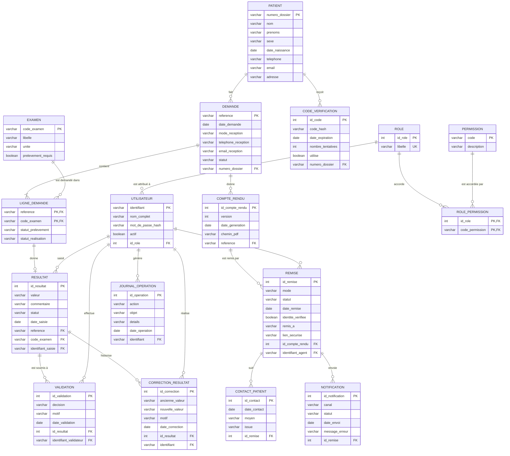

# MLD — Modèle logique de données

Logiciel de gestion des examens biologiques · Centre Médical Anne-Mathias

Ce MLD est obtenu à partir du MCD (fichier `mcd_mermaid_mocodo.md`) en appliquant les règles de passage décrites dans `explication_mcd_mld.md`. Il est de type **relationnel**, prêt à être transformé en tables SQL.

**Légende :** **PK** = clé primaire · **FK** = clé étrangère · **UK** = unicité.

## 1. Diagramme du MLD (Mermaid)

Collez ce bloc dans draw.io (Organiser > Insérer > Avancé > Mermaid) ou dans mermaid.live.

## 2. Schéma relationnel (notation classique)

Notation : <u>clé primaire soulignée</u>, `#` = clé étrangère.

| Table | Colonnes |
| --- | --- |
| **PATIENT** | <u>numero_dossier</u>, nom, prenoms, sexe, date_naissance, telephone, email, adresse |
| **DEMANDE** | <u>reference</u>, date_demande, mode_reception, telephone_reception, email_reception, statut, #numero_dossier |
| **EXAMEN** | <u>code_examen</u>, libelle, unite, prelevement_requis |
| **LIGNE_DEMANDE** | <u>#reference, #code_examen</u>, statut_prelevement, statut_realisation |
| **RESULTAT** | <u>id_resultat</u>, valeur, commentaire, statut, date_saisie, #reference, #code_examen, #identifiant_saisie |
| **VALIDATION** | <u>id_validation</u>, decision, motif, date_validation, #id_resultat, #identifiant_validateur |
| **CORRECTION_RESULTAT** | <u>id_correction</u>, ancienne_valeur, nouvelle_valeur, motif, date_correction, #id_resultat, #identifiant |
| **COMPTE_RENDU** | <u>id_compte_rendu</u>, version, date_generation, chemin_pdf, #reference |
| **REMISE** | <u>id_remise</u>, mode, statut, date_remise, identite_verifiee, remis_a, lien_securise, #id_compte_rendu, #identifiant_agent |
| **CONTACT_PATIENT** | <u>id_contact</u>, date_contact, moyen, issue, #id_remise |
| **NOTIFICATION** | <u>id_notification</u>, canal, statut, date_envoi, message_erreur, #id_remise |
| **CODE_VERIFICATION** | <u>id_code</u>, code_hash, date_expiration, nombre_tentatives, utilise, #numero_dossier |
| **UTILISATEUR** | <u>identifiant</u>, nom_complet, mot_de_passe_hash, actif, #id_role |
| **ROLE** | <u>id_role</u>, libelle |
| **PERMISSION** | <u>code</u>, description |
| **ROLE_PERMISSION** | <u>#id_role, #code_permission</u> |
| **JOURNAL_OPERATION** | <u>id_operation</u>, action, objet, details, date_operation, #identifiant |

Total : **17 tables** : 15 issues des entités du MCD et 2 tables de liaison (`LIGNE_DEMANDE` et `ROLE_PERMISSION`) issues des associations n,n.

## 3. Contraintes d'intégrité à prévoir

| Table | Contrainte | Règle du CDC |
| --- | --- | --- |
| PATIENT | `numero_dossier` unique, généré automatiquement | RG01, BF02 |
| DEMANDE | `reference` unique, `numero_dossier` obligatoire (une demande = un seul patient) | RG03, RG05 |
| LIGNE_DEMANDE | clé composite (`reference`, `code_examen`) : un examen n'apparaît qu'une fois par demande | RG06 |
| RESULTAT | `UNIQUE (reference, code_examen)` et clé étrangère composite vers `LIGNE_DEMANDE` : un résultat appartient à un examen réellement demandé | RG09, BNF03 |
| VALIDATION | `motif` obligatoire si `decision = RETOURNE_POUR_CORRECTION` | BF24 |
| CORRECTION_RESULTAT | conserve l'ancienne valeur pour toute correction importante | RG13, BF25 |
| REMISE | `identite_verifiee` obligatoire à vrai pour une remise physique ; `date_remise` renseignée seulement si `statut = REMIS` | RG21, RG24 |
| CODE_VERIFICATION | `date_expiration` obligatoire, `utilise` empêche toute réutilisation, `nombre_tentatives` limité | RG19, BNF14 |
| UTILISATEUR | `mot_de_passe_hash` jamais en clair ; `actif` permet la désactivation | BF46, BF47 |
| JOURNAL_OPERATION | lecture seule pour les utilisateurs, aucune suppression | BNF09, RG29 |

## 4. Valeurs proposées pour les colonnes `statut` et `mode`

Ces listes viennent de mes diagrammes précédents. Elles sont à **valider avec la clinique** (le CDC ne fixe pas les libellés exacts).

| Colonne | Valeurs |
| --- | --- |
| DEMANDE.mode_reception, REMISE.mode | PHYSIQUE, NUMERIQUE |
| DEMANDE.statut | ENREGISTREE, EN_COURS_ANALYSE, RESULTATS_A_SAISIR, EN_ATTENTE_VALIDATION, VALIDEE, PRETE_A_REMETTRE, REMISE, ANNULEE |
| LIGNE_DEMANDE.statut_prelevement | NON_REQUIS, EN_ATTENTE, EFFECTUE |
| LIGNE_DEMANDE.statut_realisation | EN_ATTENTE, EN_COURS, TERMINE |
| RESULTAT.statut | EN_SAISIE, EN_ATTENTE_VALIDATION, VALIDE, RETOURNE_POUR_CORRECTION |
| REMISE.statut | DISPONIBLE, EN_ATTENTE_DE_RETRAIT, REMIS |
| NOTIFICATION.canal | SMS, EMAIL |
| NOTIFICATION.statut | ENVOYEE, ECHEC, CONSULTEE, TELECHARGEE |

## 5. Choix de conception à valider

- **Remise physique et numérique dans une seule table `REMISE`** : les colonnes propres à chaque type (`identite_verifiee`, `remis_a` pour le physique, `lien_securise` pour le numérique) peuvent être vides. Alternative : une table par type.
- **`identifiant_saisie` dans `RESULTAT`** : ajouté pour tracer qui a saisi (BF48). Il n'apparaît pas dans le MCD simplifié.
- **Unité d'un résultat** : elle vient de `EXAMEN.unite`. Si l'unité peut varier d'un résultat à l'autre, ajoutez une colonne `unite` dans `RESULTAT`.
- **Valeurs de référence** : elles ne sont pas figées dans le modèle car elles doivent être configurables par une personne autorisée. Si besoin, ajoutez une table `VALEUR_REFERENCE` liée à `EXAMEN` (à définir avec la clinique).
- **Rôles** : les rôles sont des données (table `ROLE`) et non du code, pour rester configurables.
